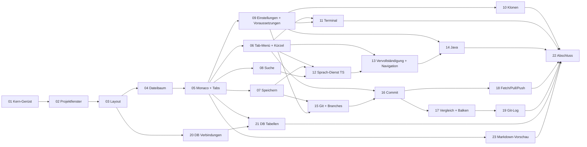

# Tickets für Codium 1

Die Tickets zerlegen die [Spezifikation](../specs/codium-v1.md) in Abschnitte, die sich einzeln umsetzen lassen. Jedes Ticket ist ein durchgehender Schnitt (Kern, Oberfläche, Tests) und lässt sich für sich prüfen. Die Reihenfolge folgt den Etappen der Spezifikation; nach jeder Etappe steht eine benutzbare App.

## Spielregeln

- **AFK** (Status `ready-for-agent`): Ein Agent setzt das Ticket allein um.
  - Er erfüllt die **„Akzeptanzkriterien“**, die alle automatisch oder am Code prüfbar sind, und liefert einen lauffähigen Stand (`npm start`, bei Bedarf ein gebautes Paket).
  - Für den Abschnitt **„Abnahme von Hand“** liefert er eine kurze Prüfliste. Die Abnahme machst du **gesammelt am Schluss** (Ticket 22), nicht nach jedem Ticket.
  - Agenten installieren den Installer nicht über eine bestehende Codium-Installation. Zum Prüfen dient `npm start` mit eigenem Entwicklungs-Datenordner bzw. das ungepackte Paket (`release/win-unpacked`).
- **HITL** (Status `ready-for-human`): Das Ticket braucht dich laufend, zum Beispiel für Rückmeldungen.
- **Ablauf pro Ticket:**
  1. **Eigener Branch:** Jedes Ticket wird auf einem eigenen Branch ab `main` umgesetzt, benannt nach dem Ticket (etwa `ticket/05-editor-und-tabs`).
  2. **Umsetzen**, bis die Akzeptanzkriterien erfüllt und alle Testläufe grün sind.
  3. **Review durch einen weiteren Agenten:** Ein zweiter Agent, der an der Umsetzung nicht beteiligt war, prüft die Änderungen des Branches gegen Ticket, Spezifikation und diese Spielregeln. Er bekommt Ticket und Branch, nicht die Einschätzung des umsetzenden Agenten, damit sein Blick unabhängig bleibt.
  4. **Befunde gemeinsam einarbeiten:** Der umsetzende Agent (Entwickler) und der Review-Agent gehen die Befunde zusammen durch und arbeiten ein, was sinnvoll ist. Im Ticket hält ein Abschnitt „Review“ kurz fest, was eingearbeitet wurde und welche Befunde mit welcher Begründung verworfen wurden.
  5. **Abschluss:** Die erfüllten Akzeptanzkriterien im Ticket abhaken; die Punkte unter „Abnahme von Hand“ bleiben offen bis zur gesammelten Abnahme in Ticket 22. Status im Ticket auf `erledigt` mit Datum setzen, ebenso den Stand in der Übersicht unten. Die Prüfliste „Abnahme von Hand“ aktualisieren, falls sich etwas ergeben hat. Danach den Branch nach `main` mergen; die Testläufe sind auch nach dem Merge grün.
  - **Alles bleibt lokal:** Ticket-Branches werden nicht gepusht, und es gibt keine Pull Requests. Gemergt wird lokal nach `main`. Gepusht wird nur, wenn der Nutzer es ausdrücklich verlangt.
  - **Branches löschen:** Ein Branch wird erst gelöscht, wenn er vollständig nach `main` gemergt ist (alle seine Commits sind in `main` enthalten) oder wenn der Nutzer es ausdrücklich sagt.
  - Ein Ticket gilt als erledigt, wenn die automatischen Kriterien erfüllt sind, alle Testläufe grün sind, das Review eingearbeitet ist und der Branch lokal auf `main` gemergt ist.
- **Der Desktop des Nutzers ist tabu:** Agenten senden keine echten Maus- oder Tastatureingaben, holen keine Fenster in den Vordergrund und ändern keine Systemeinstellungen, auch nicht vorübergehend. Geprüft wird über Tests, über Playwright mit den Entwicklerwerkzeugen der App (Chrome DevTools Protocol) und über Screenshots der eigenen Seite. Was sich nur mit echter Bedienung prüfen lässt, kommt in die Prüfliste „Abnahme von Hand“.
- **Testmodus der App** (eingeführt in Ticket 01): Für jede Prüfung der echten App (`npm start`, `electron .`, Playwright oder die gebaute `Codium.exe`) mindestens `CODIUM_TEST_HIDDEN=1` und `CODIUM_TEST_DATA_DIR=<Temp-Ordner>` setzen. Ohne beide die App nie starten.
  - `CODIUM_TEST_HIDDEN=1`:
    - Fenster öffnen ausserhalb des Bildschirms, ohne Aktivierung und ohne Taskleisten-Eintrag, und speichern ihre Lage nicht.
    - „Nach vorne holen“, „Open in Explorer“, das Öffnen externer Programme und die Zwischenablage werden nicht ausgeführt, sondern im Hauptprozess aufgezeichnet. Playwright liest die Aufzeichnung über die Auswertung im Hauptprozess.
    - Der Papierkorb ist ein Ordner im Test-Datenordner.
  - `CODIUM_TEST_DATA_DIR` ersetzt `%APPDATA%` als Wurzel des Datenordners (eigene Daten, eigene Einzelinstanz-Sperre). Ein umgeleitetes `APPDATA` allein genügt nicht.
  - `CODIUM_TEST_PICK_DIR=<Ordner>` beantwortet jede Ordnerauswahl; ohne die Variable gilt die Auswahl als abgebrochen.
  - `CODIUM_TEST_NO_GIT=1` lässt Codium so tun, als fehle Git.
- **Electron nie direkt starten:** Kein `electron .`, `npm start`, `timeout … electron.exe` o. ä., auch nicht mit eigenen Wegwerf-Skripten und auch nicht kurz. Ein solcher Start läuft ohne den Schutz des Testmodus, und eine Ausnahme beim Laden zeigt einen Fehlerdialog auf dem Desktop des Nutzers (bei Ticket 02 zweimal passiert). Wer etwas an der echten App oder an Electron selbst ausprobieren will, schreibt einen Playwright-Test über die Starthilfe (`launchCodium`).
- **Gebaute App:** Das gepackte `release\win-unpacked\Codium.exe` ignoriert `NODE_OPTIONS`. Prüfungen am gepackten Paket nur mit gesetztem Testmodus oder ohne Fenster (`ELECTRON_RUN_AS_NODE`), über `npm run test:packaged`.
- **Debug-Ports:** Für die Entwicklerwerkzeuge der App immer einen zufälligen hohen Port verwenden, nie 9222 oder 9333. Nur mit Seiten der eigenen App verbinden.
- **Shell und Zwischenablage in Prüfungen:**
  - In der echten App nie Befehle in eine PowerShell mit dem echten Profil tippen, sonst landen sie im PSReadLine-Verlauf des Nutzers. Das Testgerüst stellt cmd als Shell ein. Wo PowerShell nötig ist, `APPDATA` und `USERPROFILE` auf einen Temp-Ordner umleiten.
  - In Playwright-Tests kein Kopieren, Ausschneiden oder Einfügen in Editor oder Terminal; das ginge in die echte Zwischenablage.
- **Git:**
  - Tests und Prüfungen arbeiten nur mit Temp-Repositories. Als Remote dient ein lokales Bare-Repository; echte Git-Server werden nie angesprochen.
  - Die Git-Konfiguration des Rechners wird abgeschirmt: `GIT_CONFIG_GLOBAL` auf eine Temp-Datei, `GIT_CONFIG_NOSYSTEM=1`. Benutzername, E-Mail und Standardbranch setzen die Tests selbst. Das gilt auch für die per Playwright gestartete App.
  - Codium führt in Prüfungen nie Git-Aktionen auf dem Repository aus, in dem der Agent arbeitet.
- **Netz:**
  - Downloads aus öffentlichen Paketquellen sind erlaubt: npm, GitHub-Releases, download.eclipse.org, Maven Central, services.gradle.org.
  - Git-Remotes und Datenbanken ausserhalb des eigenen Testaufbaus bleiben tabu.
  - Tests, die Netz brauchen, laufen nur im langsamen Lauf und werden ohne Netz mit klarer Meldung übersprungen.
- **Java:**
  - Die Maven-Tests verwenden eine eigene Maven-Einstellungsdatei (Maven Central) und ein lokales Repository im Test-Zwischenspeicher, nie `~/.m2` des Nutzers.
  - Gradle verwendet ein eigenes `GRADLE_USER_HOME` im Test-Zwischenspeicher; Gradle-Daemons werden nach den Tests gestoppt.
  - Arbeitsdaten von jdtls liegen im Test-Datenordner.
  - Der Test-Zwischenspeicher ist ein von Git ausgenommener Ordner im Projekt (eingeführt in Ticket 01) und darf zwischen Läufen bestehen bleiben.
- **Datenbank:** Nur gegen PostgreSQL aus embedded-postgres testen, immer auf einem freien Zufallsport, nie 5432, Host und Port ausdrücklich gesetzt, Server nach den Tests gestoppt. Nie gegen echte Datenbanken.
- **Aufräumen:** Tests hinterlassen keine Prozesse (Shells, Sprachserver, Gradle-Daemons, PostgreSQL) und keine Temp-Ordner, ausser dem Test-Zwischenspeicher.
- **Testläufe** (eingeführt in Ticket 01): Ein Ticket fügt seine Tests dem passenden Lauf hinzu; alle Läufe bleiben grün.
  - `npm test`: schnell, bei jedem Ticket
  - `npm run test:slow`: Sprachserver, Terminal, Datenbank, Netz
  - `npm run test:ui`: Playwright gegen `dist/` mit dem Electron aus den Entwicklungsabhängigkeiten
  - `npm run test:packaged`: Prüfungen am gepackten Paket ohne Fenster
- **Vorlage THub** (`C:\workspace\THub`, ein Projekt desselben Nutzers):
  - `src/main/workspace/ports.ts`: Ports des Kerns
  - `src/main/main.ts`: Testmodus mit `THUB_TEST_HIDDEN`, `THUB_TEST_DATA_DIR`, `THUB_TEST_PICK_DIR`
  - `src/main/ptyManager.ts`: Terminal mit node-pty
  - `package.json`, Abschnitt `build.asarUnpack`: native Teile ausserhalb des App-Archivs
  - `docs/tickets/README.md`: Spielregeln, auf denen diese beruhen
- Begriffe wie „Projekt-Kern“, „Dienst“, „Port“, „Vertrag“, „Werkzeugfenster“ oder „Änderungsbalken“ sind in der Spezifikation erklärt. Vor jedem Ticket die dort genannten Abschnitte lesen.

## Übersicht

| Nr. | Ticket | Typ | Blockiert durch | Etappe | Stand |
|---|---|---|---|---|---|
| 01 | [Kern-Gerüst, Ports, Zustand und Testläufe](01-kern-geruest.md) | AFK | – | 1 | erledigt |
| 02 | [Projektfenster, Willkommensfenster, Beenden und Wiederöffnen](02-projektfenster.md) | AFK | 01 | 1 | erledigt |
| 03 | [Layout: Kopfzeile, Werkzeugfenster, Statusleiste, Meldungen, Rückfragen](03-layout.md) | AFK | 02 | 1 | erledigt |
| 04 | [Datei-Dienst und Dateibaum](04-dateibaum.md) | AFK | 03 | 1 | erledigt |
| 05 | [Monaco und Tabs](05-editor-und-tabs.md) | AFK | 04 | 1 | erledigt |
| 06 | [Tab-Menü, Tastenbelegung und Schriftgrösse](06-tab-menue-und-tastenkuerzel.md) | AFK | 05 | 1 | erledigt |
| 07 | [Automatisches Speichern, Kodierung und Änderungen von aussen](07-speichern.md) | AFK | 05 | 1 | erledigt |
| 08 | [Dateisuche, zuletzt geöffnete Dateien, Projektsuche und „Find“](08-suche.md) | AFK | 05 | 1 | erledigt |
| 09 | [Einstellungen, JDK-Erkennung, Voraussetzungen und README](09-einstellungen-und-voraussetzungen.md) | AFK | 05 | 1 | erledigt |
| 10 | [Repository klonen](10-klonen.md) | AFK | 09 | 1 | erledigt |
| 11 | [Terminal](11-terminal.md) | AFK | 06, 09 | 2 | erledigt |
| 12 | [Sprach-Dienst mit TypeScript: Definition, Verwendungen, Hover, Fehler](12-sprach-dienst-typescript.md) | AFK | 06, 07, 08 | 3 | offen |
| 13 | [Vervollständigung, semantische Färbung, Symbolsuche, Zurück und Vor](13-vervollstaendigung-und-navigation.md) | AFK | 06, 12 | 3 | offen |
| 14 | [Java-Sprachserver](14-java.md) | AFK | 09, 13 | 3 | offen |
| 15 | [Git-Dienst, Git-Konsole und Branches](15-git-und-branches.md) | AFK | 07, 09 | 4 | offen |
| 16 | [Änderungsansicht und Commit](16-commit.md) | AFK | 06, 15 | 4 | offen |
| 17 | [Vergleichsansicht und Änderungsbalken](17-vergleich-und-balken.md) | AFK | 16 | 4 | offen |
| 18 | [Fetch, Pull, Push und Konflikte](18-fetch-pull-push.md) | AFK | 16 | 4 | offen |
| 19 | [Git-Log mit Graph](19-git-log.md) | AFK | 17 | 5 | offen |
| 20 | [Datenbank: Verbindungen und Baum](20-datenbank-verbindungen.md) | AFK | 03 | 6 | offen |
| 21 | [Datenbank: Tabelleninhalt und Bearbeiten](21-datenbank-tabellen.md) | AFK | 05, 20 | 6 | offen |
| 22 | [README und Abnahme auf einem frischen Rechner](22-abschluss.md) | HITL | alle | – | offen |
| 23 | [Markdown-Vorschau](23-markdown-vorschau.md) | AFK | 05 | 1 | erledigt |

**Reihenfolge:** nach Etappen, also 01 bis 10 und 23 (gleich nach 05, weil Markdown-Dateien im Alltag schon jetzt wichtig sind), dann 11, dann 12 bis 14, dann 15 bis 18, dann 19, dann 20 und 21, zuletzt 22.

**Parallel möglich**, wenn es schneller gehen soll:
- 06, 07, 08, 09 und 23 nach 05
- 10 neben 06 bis 08, sobald 09 fertig ist
- 17 und 18
- 20 ist nur durch 03 blockiert und könnte vorgezogen werden; die vereinbarte Reihenfolge stellt die Datenbank aber bewusst ans Ende.

Tickets, die gleichzeitig am Vertrag, an der Tastenbelegung oder am Projekt-Zustand arbeiten, sollten nacheinander zusammengeführt werden.
